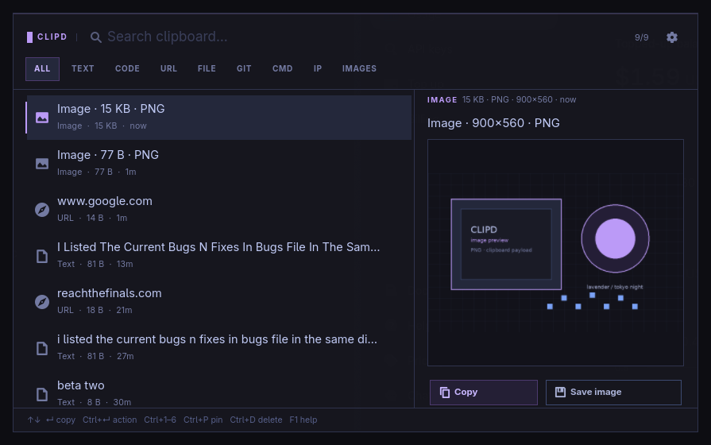

# clipd

A context-aware clipboard manager for **Arch Linux + Hyprland**.

`clipd` keeps a small local history, recognises what was copied, and offers actions that
make sense for that content: open a URL, reveal a file, clone a repository, format JSON,
save a snippet, or open a terminal with a command on the clipboard. Copied commands are
**never executed**.

The popup is a compact layer-shell surface with a Tokyo Night near-black / cool ivory /
lavender palette, sharp rectangles, a dense keyboard-first list, inline context actions,
and no network calls. GTK 4, rofi and fuzzel frontends are supported from one shared core.



```
┌──────────────────────────────────────────────────────────────────────┐
│ ● CLIPD │  Search clipboard…                              4/50       │
│  ALL  TEXT  CODE  URL  FILE  GIT  CMD  IP                            │
│ ──────────────────────────────────────────────────────────────────── │
│  ▍ https://github.com/hyprwm/Hyprland                  GIT REPO  1m  │
│    sudo systemctl restart clipd                        COMMAND   2m  │
│    {"name":"clipd","version":"0.1.0"}                  JSON      3m  │
│    def fib(n): ...                                     PYTHON    4m  │
│ ──────────────────────────────────────────────────────────────────── │
│  GIT REPO   34 B · 1 line · now                                      │
│  github.com/hyprwm/Hyprland                                          │
│  https://github.com/hyprwm/Hyprland                                  │
│                                                                      │
│  (Copy) (Clone) (Open page) (Copy git clone)                         │
│  ↑↓ copy  Ctrl+↵ action  Ctrl+1–6  Ctrl+P pin  Ctrl+D delete  F1     │
└──────────────────────────────────────────────────────────────────────┘
```

## Features

- **Automatic type detection** — http(s) and scheme-less URLs (`www.google.com`, `example.com/path`), file/folder paths, multi-file lists, Git remotes,
  shell commands, IPv4/IPv6/CIDR, email, colours, JSON, JWTs, diffs, source code, plain text.
- **Context actions** — copy URLs and files, reveal folders, clone Git repos,
  format/minify JSON, save snippets, scripts and images, decode JWTs, look up IPs,
  convert colours.
- **Searchable popup** — fuzzy search, type filters, pinned entries, inline preview,
  contextual action pills, keyboard-only operation, on the monitor under the cursor.
- **Persistent history** — SQLite, 50 most recent unique text/image entries plus
  unlimited pinned entries, survives restarts, deduplicates by content hash.
- **Pin, delete, undo** — `Ctrl+P`, `Ctrl+D`, `Ctrl+Z`.
- **Privacy by default** — local-only database (`0600`), MIME/regex exclusions, high-confidence
  secret detection, private/pause mode, optional pause-on-lock, no telemetry, no network code.
- **Safe actions** — no shell execution, no automatic execution of copied commands, validated
  URLs/paths/Git remotes, argv-only subprocesses, timeouts, and confirmation for clones.
- **Graceful clipboard edges** — capped text/image reads, timeouts, unsupported-binary
  skipping, browser image-metadata filtering, watcher supervision and self-write suppression.
- **Fallbacks** — rofi (full list + custom keys) and fuzzel (restore-first) if GTK is absent.

## Requirements

Runtime:

```bash
sudo pacman -S --needed python python-gobject wl-clipboard
```

Recommended:

```bash
sudo pacman -S --needed gtk4 gtk4-layer-shell rofi
```

Optional: `git` (clone), `wtype` (auto-paste fallback), `shellcheck` (lint command),
`fuzzel` (minimal fallback).

On Arch, `gtk4-layer-shell` must be preloaded before `libwayland-client`. The `bin/clipd`
launcher automatically re-execs the daemon with `LD_PRELOAD=/usr/lib/libgtk4-layer-shell.so`.
If you start the daemon with `python -m clipd daemon` directly, set it yourself:

```bash
LD_PRELOAD=/usr/lib/libgtk4-layer-shell.so python -m clipd daemon
```

## Install

From this checkout:

```bash
sudo make install    # DESTDIR/PREFIX supported
make test
```

Or build the package with the included local `packaging/PKGBUILD`:

```bash
cd packaging
makepkg -si
```

Both install:

- `/usr/bin/clipd`
- `/usr/lib/clipd/` (Python package)
- `/usr/lib/systemd/user/clipd.service`
- `/usr/share/clipd/config.toml` (example, never overwrites your config)
- `/usr/share/clipd/clipd.rasi` (rofi fallback theme)
- `/usr/share/clipd/hypr/` (Lua and legacy snippets)

Start it manually first:

```bash
systemctl --user daemon-reload
systemctl --user start clipd
clipd doctor
clipd toggle
```

## Hyprland configuration

The repo includes snippets in `hypr/`. `clipd setup` can install them for you and replace
an existing cliphist watcher. It is **dry-run by default** and writes backups:

```bash
clipd setup --dry-run     # show exactly what will change
clipd setup --apply       # write the Lua snippet, bind SUPER+V, disable cliphist watchers
```

It does not delete the cliphist database and does not touch the Quickshell `SUPER+C`
clipboard panel. If you use that panel, retire or rebind it yourself.

### Lua config (Hyprland 0.55+)

`clipd setup` creates `~/.config/hypr/config/clipd.lua` and adds
`require("config/clipd")` to `hyprland.lua`:

```lua
hl.bind("SUPER + V", hl.dsp.exec_cmd("clipd toggle"))

hl.layer_rule({
  match = { namespace = "clipd" },
  blur = true,
  ignore_alpha = 0.35,
  no_anim = true,
})

hl.on("hyprland.start", function()
  hl.exec_cmd("systemctl --user start clipd")
end)
```

### Legacy `hyprland.conf`

```ini
bind = SUPER, V, exec, clipd toggle
exec-once = systemctl --user start clipd
layerrule = blur on, ignore_alpha 0.35, no_anim on, match:namespace clipd
```

### Replace cliphist

`clipd setup --apply` comments out recognised `wl-paste … cliphist store` lines and stops
the running cliphist watchers. The old database is left at `~/.cache/cliphist/db`.

To import text-only history once:

```bash
clipd import cliphist --limit 200          # dry run
clipd import cliphist --limit 200 --apply
```

Images, unsupported binaries and detected secrets are skipped during cliphist migration.

## Using the popup

Open with `SUPER+V` (or `clipd toggle`). The popup appears on the monitor under the cursor.
Type to filter, use arrows to select.

| Key | Action |
|---|---|
| `↑` `↓` / `j` `k` | move selection |
| `Enter` | restore to clipboard and close |
| `Ctrl+Enter` | run the context action (Open / Clone / Save / Format…) |
| `Ctrl+1…6` | run a visible action pill |
| `Ctrl+P` | pin / unpin |
| `Ctrl+D` | delete entry |
| `Ctrl+Z` | undo last delete |
| `Tab` / `Shift+Tab` | cycle type filter |
| `Ctrl+L` | focus search |
| `Ctrl+Shift+P` | pause / resume capture |
| `Ctrl+,` | open settings |
| `F1` / `Ctrl+/` | shortcut help |
| `Esc` | close |
| double-click a row | restore |

Search prefixes: `url:`, `code:`, `file:`, `git:`, `cmd:`, `image:`, `is:pinned`.
The Git filter includes Git shell commands as well as repository links.

Primary context actions by type:

| Type | `Ctrl+Enter` |
|---|---|
| URL | Copy |
| File / folder / file list | Open / open all |
| Git repo | Clone (prompt for destination) |
| JSON | Format |
| Diff | Save patch |
| Code | Save snippet |
| IP | Open `ipinfo.io` lookup |
| Email | Open mail composer |
| JWT | Decode and copy header/payload |
| Command / plain text / colour | Copy |

`Enter` always means **copy/restore**, so the muscle memory is predictable. Actions are
listed as pills in the detail pane and in the row `⋯` menu.

### rofi fallback

If GTK is unavailable, `frontend = "auto"` falls back to rofi. Rofi gets the styled theme
`/usr/share/clipd/clipd.rasi`.

| Key | Action |
|---|---|
| `Enter` | restore |
| `Alt+Enter` | context action |
| `Alt+p` | pin |
| `Alt+d` | delete |

### fuzzel fallback

Fuzzel is restore-first: `Enter` restores. Use the GTK or rofi frontend for inline actions.
The fuzzel menu uses the same Tokyo Night / lavender palette.

## Supported content and actions

| Kind | Detection | Actions |
|---|---|---|
| URL | `http(s)` or bare `www.`/known-domain link, validated host, no credentials | Copy |
| Git repo | GitHub/GitLab/Codeberg/self-hosted `.git`, scp/ssh | Clone, open page, copy `git clone`, copy name |
| File / folder | existing absolute / `~` / `./` path | Open, reveal, copy path, copy quoted |
| File list | multiple existing paths | Open all, copy paths |
| Command | single line, known command head, `$` prompt | Copy, copy with `$`, save script, open terminal (not run) |
| Code | shebang/keywords/imports, language guess | Copy, save snippet, copy fenced Markdown |
| JSON | `json.loads` succeeds | Format, minify, save `.json` |
| Diff | `diff --git` / `@@` | Save `.patch`, copy stats |
| IP | IPv4/IPv6/CIDR | Copy, browser lookup |
| Email | RFC-ish address | Copy, compose |
| Colour | `#rgb`, `#rrggbb`, `rgb()` | Copy hex/RGB |
| JWT | 3 base64url segments + JSON header | Decode header/payload locally |
| Plain text | fallback | Copy, case transforms, save note, stats |
| Image | PNG/JPEG/GIF/WebP clipboard data | Preview, copy image, save image |

Images are capped at `max_image_bytes` and preview in the detail pane. Browser HTML
metadata accompanying a copied image is discarded; the image payload is stored instead.
Opening a URL also raises the default browser window.

## Configuration

`~/.config/clipd/config.toml` (created on first daemon start). Reload with `clipd reload`.

```toml
[general]
max_entries = 50
max_entry_bytes = 1048576      # larger text copies are skipped
max_image_bytes = 8388608      # larger images are skipped
auto_paste = "off"             # off | hyprland | wtype
paste_delay_ms = 160
terminal = "foot"

[ui]
frontend = "auto"              # auto | gtk | rofi | fuzzel | none
width = 875
height = 552
primary_action = "copy"        # copy | context
show_preview = true

[privacy]
exclude_patterns = []          # Python regexes; matching entries are not stored
exclude_mime = [
  "x-kde-passwordManagerHint",
  "application/x-kde-passwordManagerHint",
]
pause_on_lock = true
ignore_whitespace = true

[actions]
enabled = ["copy", "open", "clone", "save", "format", "lint"]
clone_dir = "~/src"
snippet_dir = "~/Snippets"
confirm_writes = true
network = true

[watch]
read_timeout_ms = 4000
```

`frontend` changes take effect after restarting the daemon. The gear button or `Ctrl+,`
opens the settings page; `Ctrl+S` saves it.

### Auto-paste (opt-in)

`auto_paste = "off"` is the default: selecting an entry only writes the clipboard.
Set `auto_paste = "hyprland"` to focus the previously active window and send `Ctrl+V`
through Hyprland's `send_shortcut`; `"wtype"` uses `wtype` as a fallback. This never types
the copied text itself and never executes commands.

## CLI

```bash
clipd toggle
clipd status [--json]
clipd list [--json] [--kind url] [--limit 50]
clipd restore <id>
clipd action <id> <action-id>
clipd pin <id> [--unpin]
clipd delete <id>
clipd undo
clipd pause | resume | reload
clipd clear [--all]
clipd doctor
clipd setup [--dry-run|--apply]
clipd import cliphist [--limit N] [--apply]
clipd daemon [--headless]
```

## Privacy and security

- History lives in `~/.local/share/clipd/history.db`, mode `0600`, with the directory `0700`.
- Text and validated PNG/JPEG/GIF/WebP images are stored. Other binary data is skipped.
- The built-in secret detector drops high-confidence private keys, AWS/GitHub/Slack/OpenAI/
  Stripe/Google/Anthropic/npm tokens before storage. Add your own rules with
  `exclude_patterns`.
- Wayland does not expose which application owns the clipboard. `clipd` therefore cannot
  offer per-app exclusions; it uses MIME hints (`x-kde-passwordManagerHint`), regex rules and
  a manual pause. Password managers that do not publish a hint may still be captured.
- Auto-paste is opt-in. Copied commands are never executed. Clone targets are validated and
  confirmed; all subprocesses use argv lists, no shell, timeouts, and process groups.
- Images are stored as validated PNG/JPEG/GIF/WebP bytes and can be previewed, copied or saved.
- Actions that write files or use the network are explicit. The application itself makes no
  network requests.
- The database is not encrypted at rest. Use `fscrypt`, `systemd-homed`, or a full-disk
  encryption setup if that matters for your threat model.

## Large clipboard entries

Text reads are capped at `max_entry_bytes` (default 1 MiB) and images at
`max_image_bytes` (default 8 MiB), with `read_timeout_ms` (default 4 s). Oversized and
unsupported binary copies are skipped, counted in `clipd status`, and never partially
stored. The watcher is restarted with backoff if `wl-paste` exits, and ignores the initial
selection at startup so a secret already on the clipboard is not silently archived.

## Architecture

```
wl-paste --watch clipd _ingest  (supervised, restart w/ backoff)
        │ stdin (capped, timed)
        ▼
 ingest: MIME hints → secret/exclusion gate → classify
        ▼  JSON over unix socket ($XDG_RUNTIME_DIR/clipd/sock, 0600)
 daemon (GLib loop)
   ├── SQLite history (50 + pinned, WAL)
   ├── action engine → validated argv / Gio launch
   ├── IPC: toggle, status, restore, pin, delete, reload…
   └── frontend: GTK4 layer-shell · rofi · fuzzel · headless
```

- `clipd _ingest` runs in a short-lived process per clipboard change, so a slow clipboard
  owner cannot stall the UI.
- The SQLite connection stays on the daemon thread. The fallback menu worker asks the main
  loop for entries instead of touching the database from a thread.
- Restores set `(hash, timestamp)` before `wl-copy`, and the daemon ignores the resulting
  watcher event.

## Development

```bash
make test              # 111 stdlib unittest cases
make check             # compile all modules
PYTHONPATH=src ./bin/clipd daemon --headless
```

Tests cover classification, URL/path/Git validation and injection, secret patterns,
retention/dedupe/pin/delete/undo, search scoring, IPC framing, fallback row mapping, action
safety, setup dry-run/apply, and an end-to-end headless daemon.

## Troubleshooting

**Popup appears as a normal window / layer-shell warnings**
Start via `bin/clipd` (it re-execs with `LD_PRELOAD`) or set
`LD_PRELOAD=/usr/lib/libgtk4-layer-shell.so` yourself. Check `clipd doctor`.

**Nothing is recorded**
`clipd status`; make sure capture is not paused (`Ctrl+Shift+P`), `wl-paste --watch` is
running, and cliphist is not also watching. `clipd doctor` reports conflicting watchers.

**SUPER+V does nothing**
Check `hyprctl binds`; run `clipd setup --dry-run`; reload Hyprland with `hyprctl reload`.

**Rofi warnings about missing theme includes**
`clipd` launches rofi with `-no-config` and passes its own theme, so user rofi config errors
cannot block the fallback.

**Restored text disappears when the source app closes**
`wl-copy` serves the selection; `clipd` does not depend on the original app staying alive.

**Auto-paste does not work in a specific app**
It is opt-in and best-effort. Set `auto_paste = "off"` and paste manually; the clipboard
content is always restored correctly.

## Uninstall

```bash
systemctl --user disable --now clipd
sudo make uninstall
# optionally remove personal data:
rm -rf ~/.local/share/clipd ~/.config/clipd
```

## License

MIT. See `LICENSE`.
